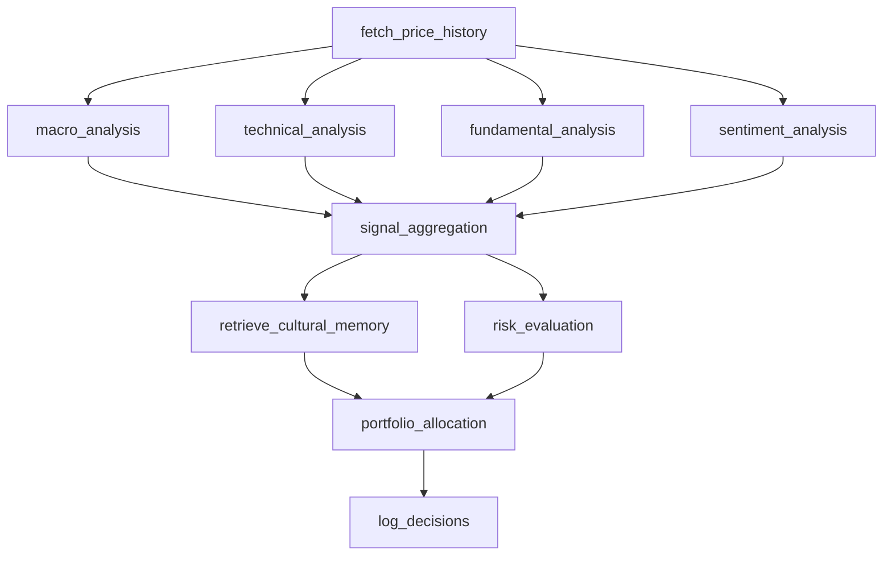

# ARGUS system guide

ARGUS turns market data and specialist judgments into a paper allocation, then
checks matured decisions against later prices. It executes no trades and keeps
no broker positions. [README](../README.md) covers running it;
[CONTRIBUTING](../CONTRIBUTING.md) owns development and verification conventions;
[limitations](limitations.md) explains the output's practical limits.

## How the system runs

| Mode | Entry point | Data and execution |
|---|---|---|
| Live request | `api.main.analyze` | Market hours, fresh cached indicators, safety gates and one shared graph lock |
| Unattended collection | `collector.run_collection_cycle_from_settings` | Same graph, called by `scheduler.collector_loop` or `scripts.collect_session` |
| Replay | `backtesting.replay.replay_session` | Recorded market data and model responses through the same graph |
| Outcome reconciliation | `reconcile.run_reconciliation_pass` | Matured logged decisions, later close prices, cultural outcomes and paper equity |

The fast clock fetches intraday candles and publishes compressed indicators.
The request clock invokes the graph and logs decisions. The slower reconciliation
clock resolves returns and feeds observed reliability back into aggregation and
portfolio sizing. Consequently, a closed-loop allocation depends on outcome
history as well as market inputs.

## Principles and evidence

1. **Degrade, never fabricate.** Missing technical indicators omit the technical
   signal. A failed news fetch yields `finbert_net_score=None` and
   `news_data_available=False`; a failed earnings-calendar fetch sets
   `catalyst_data_available=False`. Missing VIX and yield-curve readings remain
   null. Unmeasurable beta skips its statistical gate with a degraded note.
   Structural VETO results carry null risk measurements; REDUCE retains measured
   statistics and leaves uncomputed stops and marginal VaR null.
2. **The model proposes; code disposes.** `PortfolioManagerAgent._enforce_risk`
   drops unknown tickers, zeroes vetoed weights and clamps approved weights.
   `_build_allocation` recomputes dollar amounts and the residual cash reserve.
   A measured risk stop overrides a model proposal; an unmeasured stop does not.
   Pydantic validates the final contract.
3. **Inject the boundaries.** `ports.MarketDataProvider` and `ports.LLMClient`
   describe the interfaces. `seams` implements live and fixture providers.
   `GroqLLMClient.complete` reserves capacity and observes rate-limit headers;
   `structured_output.decode` owns response-validation retries.
4. **State parameter provenance.** Frozen dataclasses in `params.py` own the
   numeric defaults. `PARAMS_VERSION` is **20**. Literature, convention,
   calibration and arbitrary choices have distinct tags; arbitrary thresholds
   are assumptions, not fitted evidence.
5. **Share each contract.** `schemas.signals` owns signal types, `TickerSnapshot`
   and readiness checks. `schemas.requests` shares request bounds with settings.
   `schemas.prompting` renders model response schemas and wraps untrusted text.
6. **Safety is independent of graph execution.** The kill-switch thread watches
   drawdown and VIX. The risk node also resolves VIX directly if macro data is
   absent; if both sources fail, risk approval fails closed.
7. **Bound storage.** Each cache has a capacity, each persistent history has a
   retention policy, and expired tickers leave their owning stores.

Degradation is reported through `Diagnostics`, graph `errors`, per-signal flags,
risk notes or logs, depending on which boundary owns the evidence. An empty graph
error list alone is not proof that every measurement was available: inspect the
availability flags, null fields and risk notes too.

## One request end to end

`api.main.analyze` validates `AnalysisRequest` and the optional `X-API-Key`.
`_raise_if_halted` checks safety before execution and again after graph completion.
`_admit_live_session` checks market hours before registering tickers and checking
`LiveSessionCache.admit`: missing, stalled and stale states have distinct 503
responses. `_run_graph` uses `runtime.analyze_lock`, returns 429 when occupied,
and invokes the graph through a worker thread under the configured deadline.
The same lock protects unattended graph runs.

`state.initial_state` constructs the shared initial contract. The graph wiring
is in `orchestration.graph.build_graph`; each node is a function in
`orchestration.nodes` that takes a `GraphDeps` instance:

`node_fetch_price_history` requests the universe plus SPY in one bulk daily-bar
fetch. Intraday session states remain separate: daily closes cannot substitute
for the pipeline's five-minute technical indicators. Macro runs beside the
three specialists. A failed macro bundle does not prevent them from running.
Their concurrent error updates use the `operator.add` reducer on `ARGUSState`.

`node_signal_aggregation` joins the specialist signals with
`state.build_ticker_snapshots`. `HybridSignalAggregator` pools directional votes
weighted by conviction, base weight, macro multipliers and observed reliability.
Missing specialists reduce evidence; `agents_present` makes that visible.

Memory retrieval follows aggregation so its query can describe the current
technical posture. Risk runs in parallel with retrieval: it evaluates the whole
book for covariance and optimal weights, evaluates each ticker separately, then
maps portfolio caps onto single-ticker assessments without upgrading a VETO.
`risk_evaluation` reports its own failure and returns no usable assessments when
it cannot complete safely.

The portfolio agent builds the signal table, renders unavailable VIX as
`VIX unavailable`, computes Half-Kelly anchors where outcome evidence exists,
requests one model proposal, and enforces risk in code. `node_log_decisions`
builds one `ARGUSDecision` per universe ticker with a shared session timestamp
and attempts a PENDING cultural snapshot. The API appends the decisions to JSONL
through `asyncio.to_thread`, checks safety, then builds `AnalysisResponse`.
`vix_level` is nullable when no macro measurement exists.

A timed-out request returns 504, but its synchronous worker thread can continue
consuming provider quota. See [limitations](limitations.md).

## Module reference

Names below are stable symbol references, not line-number citations.

| Module | Owner and principal symbols |
|---|---|
| `argus/params.py` | Frozen parameter groups, `p`, `Provenance`, `PARAMS_VERSION` |
| `argus/config.py` | `Settings`, `settings`, `Settings.data_path`, `web_concurrency`; uppercase credential fields |
| `argus/schemas/signals.py` | Signals, verdicts, allocations, enums, `ARGUSDecision`, `TickerSnapshot`, `missing_session_state_keys` |
| `argus/schemas/requests.py` | Shared request types and bounds |
| `argus/schemas/prompting.py` | `schema_block`, `wrap_untrusted` |
| `argus/infra/clock.py` | `MARKET_TZ`, `now_local`, `now_market`, `as_naive_timestamp` |
| `argus/infra/files.py` | `atomic_write_text` |
| `argus/infra/backoff.py` | `full_jitter_delay` |
| `argus/infra/log.py` | `configure_logging`, `LOG_ROOTS` |
| `argus/infra/diagnostics.py` | `Diagnostics.record`, shared logs and message collection |
| `argus/ports.py` | `MarketDataProvider`, `LLMClient`, `RetryableTransportError` |
| `argus/governor.py` | `RateLimitGovernor`, `estimate_tokens`, `REGISTERED_MODELS`, `UnregisteredModel` |
| `argus/outcomes.py` | `needs_reconciliation`, `close_prices`, `compute_realized_return` |
| `argus/seams.py` | Live and fixture adapters, `GroqLLMClient`, `default_groq_client` |
| `argus/structured_output.py` | `decode`, `decode_or_degrade`, `StructuredOutputError` |
| `argus/data/fetchers.py` | Daily/intraday prices, ticker information, FRED and news fetches |
| `argus/data/retry.py` | `with_retry`, `is_retryable`, `retry_after_seconds`, `DataFetchError` |
| `argus/data/newsapi_budget.py` | `NewsApiBudget`, persistent daily request budget |
| `argus/data/cache.py` | `TTLCache`, `OHLCVBuffer`, `DailyBarCache` |
| `argus/data/indicators.py` | `compress_candles`, derived `MACD_WARMUP_BARS` |
| `argus/data/pipeline.py` | `MFTDataPipeline`, ticker registration, sweeps and publication |
| `argus/data/live_session_cache.py` | `LiveSessionCache`, freshness budgets, `AdmissionResult` |
| `argus/data/macro_features.py` | Shared FRED IDs, `cpi_yoy`, `build_macro_feature_frame` |
| `argus/data/tickers.py` | `is_valid_ticker`, shared ticker-shape validation |
| `argus/agents/technical.py` | `TechnicalStatisticalAgent`, technical scoring |
| `argus/agents/macro.py` | `MacroStatisticalAgent`, field resolution and context cache |
| `argus/agents/macro_hmm.py` | `RegimeClassifier`, `_new_hmm`, feature order and validation scenarios |
| `argus/agents/macro_context.py` | `rule_based`, `vix_regime`, `yield_curve_shape`, sector/trend/multiplier derivations |
| `argus/agents/fundamental.py` | `FundamentalAgent`, measured ratios, anonymization and model judgment |
| `argus/agents/sentiment.py` | `SentimentAgent`, FinBERT aggregates, catalyst availability and model judgment |
| `argus/agents/risk.py` | `RiskStatisticalAgent`, VaR/CVaR/beta, SLSQP and assessment builders |
| `argus/agents/portfolio.py` | `PortfolioManagerAgent`, `build_signal_table`, model proposal and enforcement |
| `argus/memory/cultural.py` | `CulturalMemoryManager`, snapshots, settled outcomes, filtered reliability/statistics |
| `argus/risk/kill_switch.py` | `KillSwitch`, initialization, VIX/drawdown gates, `drawdown_fraction` |
| `argus/risk/paper_book.py` | `PaperBook`, `compute_run_returns`, synthetic equity persistence |
| `argus/orchestration/state.py` | `ARGUSState`, `initial_state`, `build_ticker_snapshots` |
| `argus/orchestration/aggregator.py` | `HybridSignalAggregator`, `SPECIALIST_AGENTS` |
| `argus/orchestration/nodes.py` | `GraphDeps` and the ten graph node functions |
| `argus/orchestration/graph.py` | `build_graph`, dependency construction and graph wiring |
| `argus/orchestration/checkpoint.py` | `CheckpointedGraph`, `build_checkpoint_serde`, `open_saver`, `new_run_config`, `retention_cutoff`, `prune_checkpoints` |
| `argus/orchestration/decision_log.py` | Locked JSONL append/load/compaction and checkpoint decision loading |
| `argus/orchestration/attribution.py` | `credit_primary_driver`, leave-one-out attribution |
| `argus/orchestration/reconcile.py` | `reconcile_decision`, `run_reconciliation_pass`, `ReconciliationReport.summary_lines` |
| `argus/orchestration/collector.py` | `run_collection_cycle`, settings wrapper, `CollectionResult`, `CycleOutcome` |
| `argus/orchestration/scheduler.py` | `collector_loop`, `reconcile_once`, `seconds_until_next_reconcile`, `reconcile_loop` |
| `argus/backtesting/replay.py` | `replay_session`, fixture-backed graph execution |
| `argus/backtesting/evaluation.py` | Pre-registered evaluation and `pre_registered_verdict` |
| `argus/backtesting/metrics.py` | `trade_level_metrics`; no daily-equity return-series reporting |
| `api/models.py` | `AnalysisRequest`, `AnalysisResponse`; typed `PositionAllocation` response list |
| `api/guards.py` | `assert_single_worker`, process lock, registration and security checks |
| `api/lifespan.py` | `RuntimeState`, `runtime`, `lifespan`, background-loop and kill-switch startup |
| `api/main.py` | HTTP routes, admission, graph invocation, response construction |
| `scripts/` | `collect_session`, `reconcile_outcomes`, `replay_backtest`, `run_evaluation`, `train_macro_hmm` |

Import direction and the test enforcing it are documented in
[CONTRIBUTING](../CONTRIBUTING.md#import-direction).

## Storage, clocks and concurrency

| Store | Capacity or retention owner |
|---|---|
| Intraday candles | `OHLCVBuffer` prunes each ticker on insert; `compress_all` prunes untracked tickers |
| Daily candles and refresh markers | `DailyBarCache.put` bounds tickers and fetched history; `fetch_multiple_daily` prunes outside its requested set |
| Live session states | `LiveSessionCache.publish` filters the tracked universe and caps entries, evicting oldest publications |
| Agent, sector and FRED TTL caches | Mandatory positive `max_entries`, expiry sweep and oldest-entry eviction |
| Settled cultural outcomes | `MEMORY.max_trade_outcomes` (5,000), oldest session timestamp first, ID breaks ties |
| PENDING cultural snapshots | `expire_pending_snapshots` applies reconciliation retention |
| JSONL decisions | `compact_decisions_jsonl` applies the retention cutoff under the log lock |
| Graph checkpoints | `prune_checkpoints` applies the same cutoff and vacuums; called by collector and reconciliation |
| Paper-book applied runs | `PaperBook.prune_runs_applied` |
| Halt dumps | Kill-switch dump retention |
| Tracked tickers | `SYSTEM.max_tracked_tickers`, non-seed ticker TTL |

Universe policies have different owners and timings; see the
[universe-eviction limitation](limitations.md#6-architectural-trade-offs).
The default reconciliation retention combines the outcome horizon and margin.
Evicting an old settled outcome also removes it from future retrieval and
reliability estimates; it does not remove the logged decision.

Naive local persisted timestamps use `now_local`. Market-hours and live-cache
clocks use `now_market` and `MARKET_TZ`; timestamp conversion belongs at explicit
boundaries. `Settings.data_path` anchors runtime files under `ARGUS_DATA_DIR`.

The API graph lock serializes requests and collection in one process. The
single-worker guard and data-directory flock prevent a second API process on
that directory. The governor, kill switch and caches remain per-process;
independent scheduled collectors do not share quota observations. SQLite and
JSONL have their own locks. A lock protecting one store does not coordinate the
whole deployment.

## Outcomes and evaluation

`outcomes.compute_realized_return` resolves an allocated decision against later
close prices. Reconciliation stores SUCCESSFUL, FAILED or FLAT outcomes and
uses `attribution.credit_primary_driver` to assign heuristic specialist credit.
`CulturalMemoryManager.get_agent_accuracy` queries settled rows by driver and
optional regime/time filters, shrinking the observed win rate toward a neutral
prior. It returns both rate and sample count; a rate alone cannot distinguish
no history from a measured 50% win rate.

`paper_book.compute_run_returns` groups decisions by shared session timestamp,
uses only matured allocated outcomes and compounds non-overlapping run windows.
This is synthetic equity, not marked-to-market wealth. Drawdown drives the
independent kill switch. A drawdown halt persists and needs a manual reset;
a VIX blackout can clear after a genuine low reading. Before the first VIX
measurement, status reports `current_vix=None`.

Replay offers reproducible open-loop fixture execution. Closed-loop replay also
reads mutable outcome history, so reproducing it requires the same store state.
The pre-registered evaluation reports trade-level measures with uncertainty;
one captured session cannot establish predictive performance. There is no daily
strategy equity curve for Sharpe/Sortino reporting or an executable backtest.

## Operations and debugging

Start with `/health`, `/pipeline/status`, `/kill-switch/status`,
`/governor/report` and `/memory/stats`. `/health` returns 503 when an enabled
background task dies. Inspect null fields, availability flags, risk notes and
`errors` alongside the allocation. JSONL decisions are the durable per-session
record, including the image tag that produced them.

| Symptom | Evidence to inspect |
|---|---|
| Market-closed 503 | Market clock, weekday and configured hours; no exchange-holiday calendar |
| Warming-up 503 | Ticker registration, candle depth and next successful pipeline sweep |
| Stalled/stale 503 | Publication age versus bar timestamp age in `LiveSessionCache` |
| Concurrent-request 429 | `runtime.analyze_lock`, collector activity and Retry-After |
| Provider quota 429 | Governor report and response-header observations |
| Allocation unavailable | Diagnostics stage and provider/model failure; do not invent a portfolio |
| Unknown macro regime | Total bundle failure; specialists can still run |
| `model_healthy=False` | HMM artifact/window failure or unavailable reliability store, depending on the signal |
| Null beta or stop | Risk statistic was unmeasurable or not computed on that verdict |
| No sentiment/catalyst evidence | News budget, calendar errors and availability flags |
| Halt after restart | Persisted halt dump; review before calling `/kill-switch/reset` |

Set `ARGUS_LOG_LEVEL=DEBUG` when needed. `configure_logging` attaches handlers to
`argus`, `api`, `scripts` and `__main__`; each line includes module and function.
The node logger is `argus.orchestration.nodes`; the pipeline logger is
`argus.data.pipeline`.

## Tests and change recipes

The supported CI interpreter is Python 3.14. CI separates lint/format/type checks,
regular tests and uncached clean-install tests. Commands, fixture helpers and
snapshot updates live in [CONTRIBUTING](../CONTRIBUTING.md). Tests stay flat.
The golden DAG pins a committed baseline as well as checking two-run determinism;
the replay CLI has its own committed output snapshot. Tests in `test_scripts.py`
exercise command help and fixture-backed script execution. `test_layering.py`
checks all import edges, and Ruff limits statement counts.

For a new signal field, consider historical checkpoints and decision JSONL:
use nullable/defaulted fields when old records lack the measurement. Keep
schema and prompt constraints shared. For a moved symbol, update consumers and
test injection targets to its owner.

For a new specialist, update the schema, `ARGUSState`, checkpoint model allowlist,
`GraphDeps`, node wiring, `SPECIALIST_AGENTS`, aggregator weights and multiplier
keys, attribution and fixtures. A parallel writer to a shared state field needs
a reducer. Check the full evidence pool when changing conviction math.

For a model change, update `REGISTERED_MODELS`, settings and token-budget
provenance. Measure response length with the configured reasoning effort before
changing the completion budget; reasoning and output share that budget.

For macro retraining, use the training CLI and its discrimination, separation,
occupancy and recession-enrichment gates. A CONTRACTION label needs measured
USREC enrichment; it is not simply the highest-VIX state. Artifact compatibility
includes feature order, library versions and HMM covariance/iteration settings.
See [the macro walkthrough](macro_hmm.md) for the full training path.

For cadence changes, follow derived buffer depth, MACD warmup and both freshness
budgets. Keep the deployed `MFT_CANDLE_INTERVAL` and `CANDLE_BUFFER_SIZE` names.
A changed interval purges mixed-resolution buffered rows on next open.
